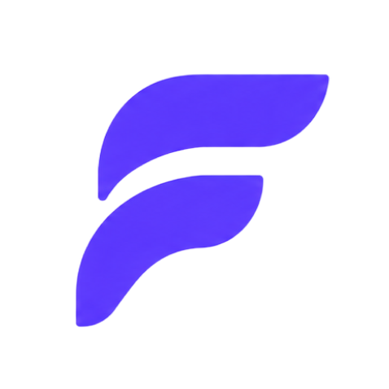
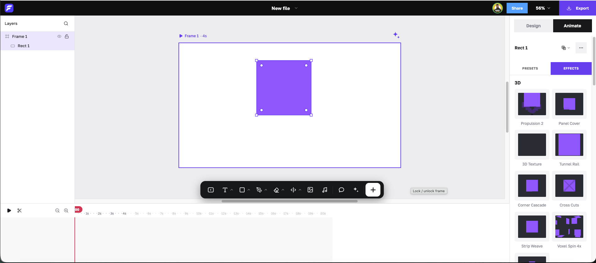

<p align="center">
  
</p>

<h1 align="center">Figtion</h1>

<p align="center">
  <a href="https://linkedin.com/in/akilgrowth/" target="_blank" rel="noopener noreferrer">LinkedIn</a> ·
  <a href="https://www.facebook.com/akilgrowth/" target="_blank" rel="noopener noreferrer">Facebook</a> ·
  <a href="https://instagram.com/akilgrowth/" target="_blank" rel="noopener noreferrer">Instagram</a>
</p>

<p align="center">
  <strong>Open-source motion design for solopreneurs and marketers.</strong><br />
  Design animations in your browser, fine-tune every detail, and export video or GIF. No install, no render farm.
</p>

<p align="center">
  <a href="https://figtion.neurotive.io/" target="_blank" rel="noopener noreferrer"><strong>Use it now → figtion.neurotive.io</strong></a>
</p>

<p align="center">
  <a href="https://figtion.neurotive.io/" target="_blank" rel="noopener noreferrer">
    
  </a>
</p>

---

## What is Figtion?

Figtion is an open-source motion design tool that runs entirely in the browser. It is an open-source clone of [Jitter](https://jitter.video): it follows the same idea of a simple, Figma-like canvas where you place shapes, text and images, add animation with a few clicks, and export a finished video or GIF.

It is built for people who need good-looking motion graphics but do not have the time (or the budget) for a full motion-design suite: solo founders, freelancers, social media managers and marketing teams producing animated content at scale.

> **Not affiliated with Jitter.** Figtion is a community-built, open-source clone. It is not made by, affiliated with, or endorsed by Jitter, and "Jitter" is named here only to describe what Figtion recreates.

## Why Figtion?

Motion design usually means choosing between two extremes: heavyweight desktop software with a steep learning curve, or simple template tools where you cannot change the details. Figtion aims for the space in between.

- **Simple to start.** The editor looks and behaves like a design tool you probably already know: layers on the left, a canvas in the middle, properties on the right. There is nothing to install and no project to set up.
- **Detailed when you need it.** Every layer has its own timeline bar, keyframes and easing, so you can fine-tune timing, movement and effects instead of accepting a preset as it is.
- **Fast to repeat.** Animation presets and a library of effects mean the same polished look can be applied across many layers, frames and files in a few clicks, which is what makes producing animated content *at scale* realistic.
- **Yours to run and change.** Figtion is open source, so you can read how it works, host it yourself, and adapt it to your own workflow.
- **Private by default.** Your work is rendered and saved in your own browser. The app has no server that stores your files.

## Who it is for

- **Solopreneurs and founders** who need launch videos, product teasers and social posts without hiring a motion designer.
- **Marketers and social media managers** who produce a steady stream of animated ads, announcements and stories.
- **Freelance designers** who want a quick way to take static designs, including layers pasted from Figma, and bring them to life.
- **Developers and tinkerers** who want to study, extend or self-host a browser-based animation editor.

## What you can make

- Animated social posts, stories and ads
- Product feature showcases and app walkthrough teasers
- Kinetic typography and animated headlines
- Promotional and seasonal offer videos
- Looping GIFs for emails, docs and websites
- Animated explainers and short intros or outros

## How it works

1. **Start a canvas.** Open the app and you get a blank frame. Set its size to match where the result will be used.
2. **Build the design.** Add shapes, text, images, video or audio from the floating toolbar, or paste layers straight from Figma. Style them in the **Design** tab.
3. **Add motion.** Select a layer, open the **Animate** tab, and pick a preset for how it comes in, goes out or draws attention. Add effects from the library for looks like glitch, dissolve, ripple, 3D card flips or color grading.
4. **Fine-tune the timing.** Drag layer bars on the timeline to change when things start and how long they last, set keyframes, and choose easing curves. Press **Space** to preview at any time.
5. **Export.** Render a video or GIF at the size you need, or save the project as a `.json` file to keep working later.

## Features

### Canvas and design

- **Frames** of any size with their own duration and background; several frames per file.
- **Layers panel** with search, show/hide, lock, grouping and rename.
- **Shapes, text, images, video and audio** layers, plus a **pen tool** for vector paths.
- **Masks and boolean operations** to combine and cut shapes.
- **Rich styling:** fills (solid, gradient, image), strokes, corner radius, opacity, blend modes, drop shadow, layer blur and background blur.
- **Comments** pinned to the canvas.
- **Paste from Figma:** copy layers in Figma and paste them into Figtion. A companion Figma plugin is included (see below).

### Animation

- **Timeline** with per-layer bars you can move and stretch, and a scrubbable playhead.
- **Keyframes and easing** for position, scale, rotation, opacity, blur, color and more.
- **Animation presets** (in / out / emphasis): grow, shrink, spin, bounce, slide, blur, mask wipes and many others.
- **Text animations**, including per-letter reveals.
- **Brainstorm panel** to explore animation ideas quickly.

### Effects library

Shader-style effects, previewed live as thumbnails and added with one click:

| Category | Examples |
| --- | --- |
| **3D** | Propulsion, Panel Cover, 3D Texture, Tunnel Rail, Corner Cascade, Cross Cuts, Strip Weave, Voxel Spin |
| **Hits** | Stack Unrolled, Spin Multiply, Hover Unstack, Popping Cards, Scene Cuts, Effect Mashup |
| **Trending** | Spinning Sphere, Snapshot 3x |
| **Distortion** | Bulge, Displacement, Fluid Warp, Fluted Glass, Noise Warp, Ripple |
| **Post FX** | Dither, Dot Grid, Duotone, Luma Highlight, Noise Mask, Pixelate, Threshold, Tritone, RGB Shift |
| **Utility** | Orbit 3D, Card Flip 3D, Color Grade, Color Remove, Grid Scroll, Inward Echoes, Noise Tile, Radial Blur, Wiggle |

Effects can be applied as a fixed look on a layer (Design tab) or as a timed animation with its own bar on the timeline (Animate tab).

### Export

- **Video** at 480p, 720p, 1080p or 4K, or at 0.5x / 1x / 2x / 3x of the frame size.
- **GIF** at 0.5x and 1x.
- **Project file** (`.json`) you can save and reopen.
- *Lottie export is listed in the menu but is not available yet.*

### Saving

- **Autosave** while you edit: your work is kept in this browser as you go, and the address updates to `/?f=<file id>` so you can reopen the file later.
- **Save and open `.json` project files** to back up or move work between browsers.

### Keyboard shortcuts

| Key | Action |
| --- | --- |
| `Space` | Play / pause playback |
| `V` | Select / move tool |
| `H` (or hold `Space`) | Hand / pan tool |
| `R` | Add rectangle |
| `O` | Add ellipse |
| `S` | Add star |
| `T` | Add text |
| `Cmd/Ctrl` + `Z` | Undo |
| `Cmd/Ctrl` + `Shift` + `Z` | Redo |
| `Cmd/Ctrl` + `D` | Duplicate the selected layer |
| `Backspace` / `Delete` | Delete the selected layer |
| `Cmd/Ctrl` + `0` | Fit the canvas to the window |
| `Cmd/Ctrl` + `1` | Reset zoom to 100% |

### Templates and Explore

Beyond the editor, the app includes a **Templates** page with ready-made starting points, such as *Kinetic Typography Promo*, *Product Feature Showcase* and *Holiday Special Offer*, and an **Explore** page with a live animation showcase. A **Shortcuts** page lists the keyboard reference above.

## Try it

No setup is needed to use Figtion: open **<https://figtion.neurotive.io/>** and start designing on the canvas.

## Run it locally

You need [Node.js](https://nodejs.org/) 18 or newer.

```bash
git clone <this repository>
cd figtion-motion
npm install
npm run dev
```

The app opens at <http://localhost:3000/>.

### Scripts

| Command | What it does |
| --- | --- |
| `npm run dev` | Start the dev server on port 3000 |
| `npm run build` | Production build into `dist/` |
| `npm run preview` | Serve the production build locally |

## Deploying

Figtion is a static single-page app. The live site runs on **Cloudflare Workers** with static assets; [`wrangler.jsonc`](wrangler.jsonc) is already set up for it.

```bash
npm run build
npx wrangler deploy
```

Any static host works if it serves `index.html` for unknown paths (the app uses client-side routing).

## Where your files are stored

This matters, so it is worth being direct about it:

- Your files are saved **in your browser** (IndexedDB), not on a server.
- Files **do not sync between devices or browsers**, and clearing site data deletes them. Use **Save as `.json`** from the editor to keep a backup.
- How much you can store is decided by your browser, not by Figtion.
- A file's address (`/?f=<file id>`) only opens it in the browser where it was saved. It does not give other people access to your file.
- There is no file list page: reopen a file from its address, or open a saved `.json` project.

Cloud storage is the natural next step and is on the roadmap below.

## Project structure

```
Figtion/
├── index.html              # app shell, title and meta tags
├── public/
│   ├── legacy-editor.html  # the full editor (canvas, timeline, effects, export), hosted in an iframe
│   ├── Logo/               # logo, favicon source and README screenshot
│   └── icons/              # app icons
├── src/
│   ├── App.tsx             # routes
│   ├── pages/              # Editor host, Templates, Explore, Shortcuts
│   ├── context/            # EditorContext
│   ├── engine/             # rendering, effects and animation helpers
│   └── components/         # shared UI
├── figma-plugin/           # Figma plugin to copy designs into Figtion
├── wrangler.jsonc          # Cloudflare Workers config
└── vite.config.ts          # Vite and PWA configuration
```

The editor itself is a self-contained page that the React app loads full-screen in an iframe. This keeps the editor's own styles, keyboard shortcuts and clipboard handling isolated from the rest of the app (routing, templates, shortcuts).

## Tech stack

- **React 19** and **React Router**
- **TypeScript**, **Vite**
- **Tailwind CSS** and **Radix UI**
- **Canvas 2D** and **WebGL** for rendering and effects
- **vite-plugin-pwa** for installability and offline support
- **Cloudflare Workers** for hosting

## Figma plugin

The [`figma-plugin/`](figma-plugin) folder holds a small plugin, "Figtion · Copy to app", that copies selected Figma layers so you can paste them into the Figtion canvas.

1. In Figma, choose **Plugins → Development → Import plugin from manifest…**
2. Pick `figma-plugin/manifest.json`.
3. Select layers in Figma, run the plugin, then paste into Figtion.

The plugin does not use the network.

## FAQ

**Is Figtion the same as Jitter?**
Figtion is an open-source clone of Jitter: it recreates Jitter's approach to simple, approachable motion design, and you can run it and change it yourself. It is a separate project and is not made by or affiliated with Jitter.

**Do I need an account?**
No. Open the editor and start designing.

**Where does my work go?**
It is saved in your browser's own storage as you edit, and nothing is uploaded to a Figtion server. Use **Save as `.json`** for backups, and remember that clearing your browser's site data removes saved files.

**What can I export?**
Video (480p up to 4K, or at 0.5x to 3x of the canvas size) and GIF (0.5x and 1x). Lottie export is planned.

**Can I bring in designs from Figma?**
Yes. Copy layers in Figma, and paste them into the Figtion canvas. A small companion Figma plugin is included for copying layers.

**Does it work offline?**
The app is a progressive web app and can be installed, but the large editor page is deliberately not cached, so it is always fetched fresh. In practice, opening the editor needs a connection.

**Can I host it myself?**
Yes. It is a static single-page app: build it with `npm run build` and serve the `dist/` folder from any static host that falls back to `index.html`.

## Roadmap

- [ ] Cloud storage and sync across devices
- [ ] Per-user storage limits and a usage meter
- [ ] Sharing a file with other people, not just yourself
- [ ] Lottie export
- [ ] Higher-resolution GIF export

## Contributing

Contributions are welcome.

1. Fork the repository and create a branch for your change.
2. Run the app locally with `npm run dev` and test your change in the browser.
3. Keep changes focused, and describe what you changed and why in your pull request.
4. For larger changes, open an issue first so we can agree on the approach.

Bug reports are most useful when they include the steps to reproduce, your browser and version, and a screenshot or screen recording.

## Credits

Figtion is a clone of [Jitter](https://jitter.video), built in the Figma-style way of working. All product names and trademarks belong to their respective owners.

## License

Released under the [MIT License](LICENSE). You are free to use, copy, modify and distribute Figtion, including commercially, as long as the copyright and license notice are kept.

Figtion is not affiliated with Jitter, and any third-party names, logos or trademarks mentioned belong to their owners.
